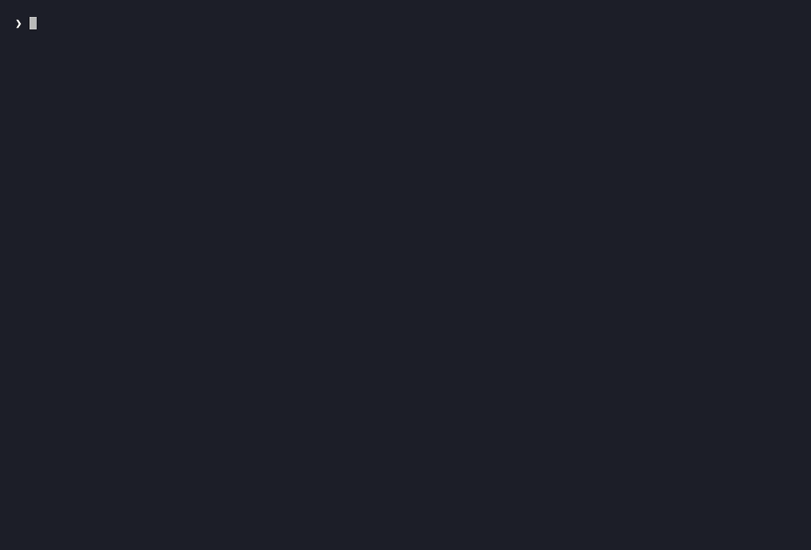

# ARIES

[🇮🇹 Italiano](README.it.md) · **🇬🇧 English**


<p align="center">
  
</p>

Security testing that is **local, deterministic and honest** — attacker and defender on your own infrastructure.

> **Principle — ground truth:** the facts are produced by the **code**, with the evidence right next to them. The LLM, when present, at most *interprets* — it never decides whether a check passes. ARIES works entirely **without models**.

## Scope boundary

ARIES acts **only** on the hosts in `ALLOWLIST`, a check enforced inside `core.probe()` so that **no lane can bypass it**. Only your own infrastructure and authorized labs. The default is **loopback only** (`localhost` / `127.0.0.1`, for the fixture and the `bench`): your hosts are added in an **untracked** `config_local.py` — copy `config_local.example.py`, put your domains in `ALLOWLIST_EXTRA`, and `config.py` loads it on its own (so your infrastructure never ends up in the repo). Passive lanes are the default; the active ones (which send payloads) are explicitly opt-in and print a warning.

## Authorized use

ARIES is an **offensive** security-testing tool: some lanes send real payloads. Use it **only** on systems you own or for which you have **written** authorization to test. The `ALLOWLIST` boundary is there to make it hard to point elsewhere, but responsibility for its use remains with whoever runs it: testing third-party systems without permission is illegal in most jurisdictions. The authors assume no liability for misuse.

## Commands

```
# Defense (passive, read-only)
check      web hygiene: headers (presence + value-aware HSTS/CSP/nosniff/XFO), cookies (flags + CSRF defense via SameSite), exposures, auth/API gates
secrets    secrets exposed in a repo (orchestrates gitleaks, --redact)
sast       vulnerabilities in the code (orchestrates semgrep, noise tamed)
deps       known CVEs in the dependencies (orchestrates trivy)

# Offense (active, opt-in)
discover   hidden endpoints/directories (orchestrates ffuf)
auth       login resistance to brute-force (fake username)
attack     SQL injection: error-based + boolean-based + time-based (blind)
xss        server-side reflected XSS
stored-xss stored/persistent XSS: the payload written to one endpoint re-emerges un-escaped from another (two URLs)
ssti       Server-Side Template Injection (arithmetic expression evaluated by the template)
dom-xss    client-side DOM-XSS (headless browser, Playwright)
idor       broken access control (header or Bearer token; id in query or in the path)
traversal  path traversal / LFI: does a file parameter escape the root and read /etc/passwd or \windows\win.ini (even via NUL truncation), does the php://filter wrapper disclose the source of a PHP script, or does the data:// wrapper include and execute an attacker-chosen stream (RCE)?
nosqli     NoSQL operator injection in the login (auth bypass via $ne/$in; JSON body or bracket-notation form `field[$op]=`)
jwt        JWT weaknesses: alg=none, weak HS key (offline brute), exp ignored
race       race condition / TOCTOU (concurrent requests + post-burst anti-FP guard)
redirect   open redirect (external canary, with allowlist bypass)
crlf       CRLF / HTTP response header injection: a param writes raw CR-LF into a header → split (structural proof: the injected sentinel header re-emerges in the response)
cors       CORS misconfiguration: arbitrary Origin reflected + credentials (GET + preflight OPTIONS)
ssrf       SSRF: does the server follow a client-chosen URL? (local out-of-band canary, valid for blind SSRF too)
tls        TLS/transport hygiene: expired/invalid certificate, deprecated protocol (<TLS 1.2) — handshake only
graphql    GraphQL: introspection exposed, field suggestion ('Did you mean'), unlimited query batching, mutation via GET or form POST (CSRF)
xxe        XXE: does an API that parses XML resolve external entities? (SYSTEM file:///etc/passwd entity → arbitrary file read; file signature, not reflection)
csrf       CSRF: is the anti-CSRF token validated on a state-changing endpoint? (differential proof)
mass-assign mass assignment: can the client set a server-controlled field (e.g. role)? (decoy field as guard)
nuclei     template-based web scanner (orchestrates nuclei)

# Discovery
openapi    reads an OpenAPI/Swagger spec and runs the lanes against the DECLARED endpoints
fuzz       parser fuzzer: crashes and DoS (timeout for hang/ReDoS)

# Engine
scan       composes the applicable lanes + regression diff (sentinel); --report → Markdown/HTML/SARIF (.sarif → GitHub code scanning)/JUnit (.xml → CI runner) report; --fail-on <sev> → absolute CI gate (exit≠0), --fail-on-new <sev> → regression-only gate
history    a target's trend over time from the findings-DB (read-only): scan series + issues with their age; --report → Markdown/HTML dashboard
bench      self-validation: every active lane with a true positive + a true negative
```

Invocation: `python3 aries.py <command>`, or — after `pip install -e .` —
the `aries <command>` command from any directory (see [Packaging](#packaging-pip-install--e-)).
Every command accepts `--json`.

## Authenticated surface (session: `--cookie` / `--token` / `--header`)

Much of the real attack surface lives **behind the login**, where without
a session you only see the authentication wall. The `check`, `xss`,
`scan`, **`attack` (sqli), `ssti`, `nosqli`, `cors`, `ssrf`, `traversal`,
`stored-xss`, `redirect` and `race`** commands accept three **session** flags,
routed centrally inside
`core.probe()` (so **no lane can ignore them** and the **ALLOWLIST boundary
holds**: the session adds credentials toward the same authorized host, it does not
reach new hosts):

- `--cookie 'sid=…'` → `Cookie` header (the logged-in browser session);
- `--token '<jwt>'` → `Authorization: Bearer <jwt>` header (token APIs);
- `--header 'K: V'` → custom header, **repeatable** (e.g. `--header 'X-Api-Key: …'`).

```
# reflected XSS on a RESTRICTED page (without the cookie you only see the login wall)
python3 aries.py xss 'http://127.0.0.1:8099/area/cerca?q=X' --param q --cookie 'sess=…'
# header hygiene evaluated on the AUTHENTICATED page, not on the public login
python3 aries.py check http://127.0.0.1:8099/dashboard --token "$TOKEN"
python3 aries.py scan http://127.0.0.1:8099/app --active --cookie 'sess=…'
```

The `curl` PoC reproduces the authenticated request but **masks** the credential
(Bearer → `$TOKEN`, Cookie → `$COOKIE`): the secret does not enter the report.
**Honesty:** without a valid session the lane on the restricted page **stays silent**
(it sees the login wall, nothing is reflected) → ARIES asserts nothing about a
surface it does not reach. The session is routed — with the same
`probe(session=…)` / `as_curl(session=…)` pattern — into `check`, `xss`, `scan` and **all
the active single-target lanes**: **sqli** (`attack`), **ssti**, **nosqli**,
**cors**, **ssrf**, **traversal**, **stored-xss**, **redirect** and **race**.
`stored-xss` routes it into **both** probes (write + read → a board behind the
login); `race` does not go through `core.probe` (it opens direct urllib sockets,
like `tls`) so it merges the session into the **headers** of every concurrent
request, with the `ALLOWLIST` boundary enforced in the lane. Forwarding each of
them down to `core.probe` (or, for `race`, into its headers) is verified by the
dedicated self-check (`SESSION-THREADING`, now **9 lanes**); XSS and SQLi behind
authentication have their own two-sided end-to-end benchmark (`Auth-XSS`/`Auth-SQLi`
rows), and **stored-XSS behind the login** has its own (row `Auth-StoredXSS`): without
the session the write is rejected and the read is the login wall → the canary does not
re-emerge and the lane **stays silent** (no FP), with the session the restricted board
is reached and the un-escaped persistence is exposed. Lanes that already carry their
own identity (`idor`/`jwt` with the token, `csrf`/`mass-assign` with `--cookie`) do not
use these generic flags.

## PoC by construction

Every "VULNERABLE" finding carries the **exact `curl` command that reproduces it**, generated from the *same* request the lane sends — it cannot diverge. Bearer tokens are masked with `$TOKEN` (the JWT does not end up in the report).

## Benchmark

Every active lane is born with a two-sided benchmark — it catches the **vulnerable** *and* does not flag the **safe**. A local fixture (`bench_vuln.py`, `127.0.0.1` only) runs it all at once:

```
python3 aries.py bench
echo $?    # 0 if GREEN, 1 if anything regresses
```

**Exit-code (CI gate).** `aries bench` exits with **code 0** only when it is
**GREEN**: every non-exempt lane at 2/2 (true positive + true negative) **and** all
the non-lane self-checks OK. If a lane regresses or a self-check fails it exits with
**code 1**, so a GitHub Action can **block the commit** that breaks the tool.
The `dom-xss` lane is **exempt** from the gate (it requires Playwright, which in
cloud/CI may be missing): `core.bench_green` excludes it from the score. The decision
is a **pure** function (`core.bench_green`) covered by a deterministic self-check
(`BENCH-GATE`). This repo self-checks with that gate on every push →
[`.github/workflows/bench.yml`](.github/workflows/bench.yml).

### Adversarial bench — the 3rd face

The two-sided bench tests *vulnerable* + *safe*. What is missing is the **healthy but
deceptive** case: an endpoint that is NOT vulnerable but **looks** like it is. The
adversarial bench is a **global anti-false-positive gate** (not a lane, it does not
enter the `/N` score, like the gates and the report): it points **every covered lane**
at its trap and demands **silence** (a non-VULNERABLE verdict) — so the robustness of
what already exists is *measured* against bad inputs, not just against the two-sided
fixtures.

The traps (in `bench_vuln.py`, `127.0.0.1` only): **verbatim echo** of the payload
(reflects but does not execute/evaluate/include/fetch), **200-to-everything** SPA style
(same body for every input), **echo of the request headers** (Origin/Authorization in
the body, never in the response headers), **sub-threshold random latency** (network
jitter). Many lanes already have a guard of this kind (the CSRF's `D`, the SSRF canary,
the mass-assign decoy, the SSTI product, the traversal signature, the equal-length
differential of boolean-SQLi): here it is made **systematic** and benchmarked for all
of them. The self-check covers **22 lanes** (SQLi, SQLi-time, XSS, Redirect, **CRLF**,
CORS, SSTI, NoSQLi, Stored-XSS, CSRF, Mass-assign, SSRF, Traversal, JWT, GraphQL,
**IDOR**, **IDOR-token**, **IDOR-idecho**, **IDOR-idecho-path**, **Auth**, **Race** and
**XXE**). **CRLF** is covered by the same structural proof that defines it: the
`/trap-echo` trap reflects the payload into the **body**, never into a header → the
sentinel header never materializes → the lane stays silent (no false positive from
reflection). **XXE** is covered by the same structural proof: against `/trap-echo`
(which reflects the XML body — `&xxe;` / the DOCTYPE) the signature `root:…:0:0:` never
materializes → the lane stays silent (we send an entity *reference*, never the file
content → the echo does not produce it).

**IDOR** got the guard it was missing: it was the only *differential offensive* lane
excluded from the bench, because the verdict was based on *status* alone
(owned=200 ∧ other=200) and a 200-to-everything trap would have been read as "someone
else's resource accessible." Now `lane_idor` also compares the **content**: it asserts
IDOR only if, at equal status 200, the body of the other person's resource **differs**
from mine (per-user data); if the bodies are **identical** (200-to-everything SPA,
public resource with a constant body) it stays silent. Pointed at `/trap-spa`
(query and token/path) → silence.

A **second content guard** closes the **ID-ECHO** endpoint case: the one that reflects
**only the requested id** in a constant shell (e.g. an SPA that puts the id in the body,
a route open to any id). There the bodies of `owned` and `other` **differ** — but only
for the reflected id, not for stored data — so the first guard (identical bodies) does
not fire. The second one then probes a **nonexistent** id (a deterministic sentinel): a
**real per-id resource** rejects the unknown id (404/403) → the different body of `other`
is real other-user data → **attributable IDOR**; an endpoint that answers **200 to any
id** (even a nonexistent one) is **not** a stored per-id resource → the difference is
only the reflected id → the lane **stays silent**. Pointed at `/trap-id-echo` (query and
path) → silence. A **normalization** of the id in the bodies would not do (the id often
appears *inside* the real per-user data, e.g. `"basket of user 1"` → false negatives):
the nonce probe is the **objective** signal (real store vs open endpoint), not a
similarity threshold. Honest limit: an endpoint that returns 200 even for a nonexistent
id **and** real data for the other ids would be silenced — a conservative choice toward
anti-FP, declared.

**Auth** got the dedicated trap `/trap-auth-lockout`: a **healthy but deceptive** login
that does NOT use the canonical 429, but locks out via a **status transition** (401 on
the first attempts, then 403 and stays there). To a naive scanner (which only looks for
429/423) it looks like "no throttling" → false positive. The lane now has two more
signals beyond 429/423: a **`Retry-After`** header (RFC 7231, status-agnostic) and the
**late and persistent transition** toward a blocking status (`_lockout_transition`,
conservative: a login truly without defense — same status every time — stays VULNERABLE).
Pointed at `/trap-auth-lockout` → silence (lockout recognized, no "no rate-limit" FP).

**Race** got a **post-burst** guard: counting concurrent successes alone (ok > 1) is not
enough, because a **200-to-everything** (or an idempotent operation) succeeds N× *by
construction*, not because of a TOCTOU. After the burst the lane sends a **sequential**
request: a "once only" operation has consumed the resource with the burst → the
sequential one is **rejected** (non-2xx) → the race is attributable; if instead it still
succeeds (2xx) the endpoint is **repeatable** → the N successes prove nothing → the lane
**stays silent**. Pointed at `/trap-spa` (200-to-everything, sequential post-burst 200) →
silence. Honest limit: a once-only operation whose resource does not exhaust within the
burst (quota > N, or that answers 2xx idempotently even after consumption) is silenced —
a conservative choice toward anti-FP, declared.

Honest limits — lanes **not covered**, and why:
**DOM-XSS** (requires Playwright, exempt from the bench in the cloud);
**TLS** (the traps are HTTP endpoints, not TLS servers: the verdict is still born from
OpenSSL's verification code, not from a reflected string → not deceivable by
construction).

## OpenAPI/Swagger ingestion

`openapi` reads a spec (JSON, or YAML if `pyyaml` is present) and enumerates the
endpoints **from the contract** — it does not guess them like `discover`. On every
applicable operation it runs the deterministic lanes: `check` (on the base), `xss`
(reflected on every string parameter), `sqli` (on logins with a credential field),
`auth` (login brute-force resistance), `nosqli` (operator-injection on logins, opt-in),
`ssti` (template injection on string parameters, opt-in), `traversal` (path traversal /
LFI on file-like parameters, opt-in), `redirect` (open redirect on redirect-like
parameters in GET, opt-in), `ssrf` (Server-Side Request Forgery on URL-like parameters,
opt-in), `crlf` (CRLF / response-header injection on header-sink parameters in GET,
opt-in), `idor` (reading per-id resources) and `jwt` (token-verification weaknesses on
GETs protected by a bearer scheme — the token is needed via flag).
The dispatch is mechanical: the spec declares the name, location and type of every
parameter. With `ssrf` and `crlf`, **all** the per-parameter lanes are dispatchable from
the contract; `idor` and `jwt` are the **token/identity** lanes (the spec declares WHERE
authentication is needed, not the credential's value).

**Schema composition resolved.** Real specs constantly compose the bodies of their
requests: `allOf` (a base model via `$ref` **plus** local fields), `oneOf`/`anyOf`
(variants). Parameter enumeration **resolves** this composition — `allOf` merges the
fields of all members, `oneOf`/`anyOf` takes their **union** (every field that *can*
appear is an injectable surface to test), following nested local `$ref`s. Without it, a
composed body would expose **zero** properties (the `allOf` container has no `properties`
of its own) → the dispatch would skip the endpoint and the surface declared by the
contract would be lost. The `OpenAPI-compose` benchmark proves this two-sided: a login
whose body is an `allOf` of a `$ref` (with `username`) and an inline member (with
`password`) → `auth` dispatches **only** if it recognizes **both** fields, so the row is
green ⟺ the composition is actually merged.

- **`auth`** fires when a POST/PUT/PATCH operation declares in its body both an
  **identity** field (`username`/`email`/`login`/…) **and** a **password** field
  (`password`/`pass`/`pwd`/…): the dual requirement marks a **login** from the contract,
  distinguishing it from creating a resource with an email field (on which brute-force
  would make no sense). The lane sends attempts with a **fake** username (it does not
  touch real accounts) and watches whether throttling appears, from three signals:
  **429/423** (explicit throttle), a **`Retry-After`** header (a defense that does not
  change the status), or a late and persistent **status transition** toward a blocking
  status (e.g. 401→403 = IP/account lockout / step-up, without the canonical 429). None
  of the three → VULNERABLE. No real credentials are needed, so it is entirely
  spec-driven: you no longer have to *know* where the login is: the contract says so.
- **`nosqli`** has the **same trigger** as `auth` (a body with an identity field **and**
  a password field = a login from the contract) and tests **NoSQL operator-injection**
  on the identity field (`{"$ne": …}` always-true → bypass if evaluated). It uses a
  **fake** username (it does not touch real accounts), so it too is entirely
  contract-driven. The **transport** is told by the declared content-type: an
  `application/json` body → operator in the JSON body; an
  `application/x-www-form-urlencoded` body → bracket-notation `field[$op]=`. Unlike
  `auth`, it is **not** in the default: it must be requested explicitly
  (`--lanes …,nosqli`), so as not to change the output of `openapi` unrequested. The
  `OpenAPI-nosqli` benchmark proves it two-sided (it reuses the `/nosqli-{vuln,safe}`
  fixtures): the login that **evaluates** the operator → VULNERABLE, the one that
  **coerces it to a string** → silence.
- **`ssti`** has the **same target** as `xss` (every **string** parameter reflected in
  query/body/form) but tests the **server-side evaluation** of a template expression, not
  just the reflection: it injects `marker{{887*883}}` and distinguishes three outcomes —
  `marker` + the **computed 783221** → SSTI confirmed; `marker` + the **literal** payload
  → reflected but not evaluated (plain reflection, not SSTI, the classic false-positive
  trap); marker absent → not reflected. It is entirely contract-driven (no credential)
  but, like `nosqli`, it is **not** in the default: it must be requested explicitly
  (`--lanes …,ssti`), so as not to change the output of `openapi` unrequested. The
  `OpenAPI-ssti` benchmark proves it two-sided (it reuses the `/ssti-{vuln,safe}`
  fixtures): the parameter that passes through the template engine → VULNERABLE, the one
  **escaped as data** → silence.
- **`traversal`** (Path Traversal / LFI) targets every **string parameter that carries a
  FILE NAME / PATH** (`file`/`page`/`path`/`template`/`download`/…, or a name containing
  `file`/`path`) — **not** every string parameter: as `idor` picks only the id-like ones
  in the path, `traversal` picks only the file-params (a `username`/`q` is not a
  file-read). The proof is the **objective signature** (the content of a known system
  file, e.g. `root:…:0:0:`), not reflection → a raw reflected parameter does not produce
  it, so spraying the file-params introduces no false positives. It is entirely
  contract-driven (no credential) but, like `nosqli`/`ssti`, it is **not** in the default:
  it must be requested explicitly (`--lanes …,traversal`), so as not to change the output
  of `openapi` unrequested. The `OpenAPI-trav` benchmark proves it two-sided (it reuses
  the `/download-{vuln,safe}?file=` fixtures): the download that naively joins the name →
  `../` escapes the root → VULNERABLE, the one that reduces to a **basename** → confined →
  silence.
- **`idor`** fires on every **GET** operation with an **id-like parameter in the PATH**
  (`/basket/{id}`, `/users/{userId}`, `…/{order_id}`): a per-identifier resource read.
  That placeholder becomes the point where `idor` substitutes **your** resource and
  **someone else's**; the other placeholders are concretized to a sample value. Unlike
  `auth`, `idor` is **not** in the default and requires an **identity** (`--token`, or
  `--id-header` + `--identity`): the spec declares it as a requirement
  (`securitySchemes`) but does not carry its *value*. If you request `--lanes …,idor`
  without passing it, the lane is not executed and `openapi` declares it (finding
  `idor:spec`, info).
- **`redirect`** (open redirect) targets every **GET** operation with a **redirect-like
  QUERY string parameter** (`to`/`url`/`next`/`redirect`/`return`/…, or a name containing
  `redirect`/`return`) — **not** every string parameter: as `traversal` picks only the
  file-params and `idor` only the id-like ones in the path, `redirect` picks only the
  redirect-like parameters (a `q`/`username` does not redirect). The proof is the
  **objective signature** (a `3xx` with `Location` toward the **external canary**
  `example.com`, never contacted — `core.probe` does not follow redirects), not
  reflection → a raw reflected parameter does not produce it, so spraying the
  redirect-params introduces no false positives. It is entirely contract-driven (no
  credential) but, like `nosqli`/`ssti`/`traversal`, it is **not** in the default: it
  must be requested explicitly (`--lanes …,redirect`), so as not to change the output of
  `openapi` unrequested.
- **`ssrf`** (Server-Side Request Forgery) targets every **string parameter that carries
  a URL** that the server will go and **fetch** (`url`/`uri`/`webhook`/`callback`/
  `src`/`image`/…, or a name containing `url`/`webhook`/`callback`) — **not** every
  string parameter: as `redirect` picks only the redirect-like ones, `traversal` only the
  file-params and `idor` only the id-like ones, `ssrf` picks only the URL-like parameters
  (a `q`/`username`/`page` does not trigger a server-side fetch; `uri` is an **exact**
  name, not a substring, so as not to take the bait on `security`/`maturity`). The proof
  is **objective and out-of-band** (the **local canary** hit with the nonce, not
  reflection), so a raw reflected parameter does not produce it → spraying only the
  URL-params introduces no false positives. The **transport** is told by the declared
  location: a **query** parameter → fetcher via GET; a **body/form** field → webhook via
  POST. It is entirely contract-driven (no credential) but, like
  `nosqli`/`ssti`/`traversal`/`redirect`, it is **not** in the default: it must be
  requested explicitly (`--lanes …,ssrf`), so as not to change the output of `openapi`
  unrequested.
- **`crlf`** (CRLF / HTTP Response Header Injection) targets every **GET** operation with
  a **HEADER-SINK query string parameter** — whose value can end up in a **response
  header**: the canonical sink is the `Location` of a redirect, so the set is the
  **union** of the redirect-like **and** url-like names (`to`/`url`/`next`/
  `redirect`/`webhook`/…) — **not** every string parameter: as `redirect` picks only the
  redirect-like ones and `ssrf` only the url-like ones, `crlf` targets only the
  header-sinks (a `q`/`username` does not end up in a header). The proof is **objective
  and structural** (the injected sentinel header **re-emerges as a response header** →
  the CR-LF was written raw and broke the header), not reflection in the body → a raw
  reflected parameter does not produce it, so spraying only the header-sinks introduces
  no false positives. It is entirely contract-driven (no credential) but, like
  `nosqli`/`ssti`/`traversal`/`redirect`/`ssrf`, it is **not** in the default: it must be
  requested explicitly (`--lanes …,crlf`). With `ssrf` and `crlf`, **all** the
  per-parameter lanes are dispatchable from the contract.
- **`jwt`** (token-verification weaknesses) fires on every **GET** operation that the
  spec declares **protected by a bearer scheme** (`securitySchemes` with
  `type: http, scheme: bearer`): that is where an `Authorization: Bearer <token>` is
  accepted → that is where it makes sense to test `alg=none`, the **weak HS key** (offline
  brute) and the **ignored `exp`**. Unlike `xss`/`ssti` (every parameter), `jwt` targets
  only the endpoints the **contract** declares protected — as `idor` targets only the
  id-like ones in the path. Like `idor`, the spec says **where** the token is accepted but
  does **not** carry its *value*: the legitimate token arrives via `--token`; if you
  request `--lanes …,jwt` without passing it, the lane is not executed and `openapi`
  declares it (finding `jwt:spec`, info). GET **only** (read, no side effects, like
  `idor`). The verdict is **objective** (a forged token accepted with HTTP 200, or the
  signature reconstructed offline), with the lane's anti-FP guard (a **broken** signature
  rejected → the bypass is attributable). `jwt` and `idor` are the two **token/identity**
  lanes of the dispatch.

```
python3 aries.py openapi api-spec.json
python3 aries.py openapi api-spec.yaml --base http://127.0.0.1:8099 --lanes xss,sqli,auth --json
# NoSQLi from the contract: opt-in on the declared logins (username + password in the body)
python3 aries.py openapi api-spec.json --lanes nosqli
# SSTI from the contract: opt-in on the reflected string parameters (server-side template evaluation)
python3 aries.py openapi api-spec.json --lanes ssti
# Traversal from the contract: opt-in on the file-like parameters (path traversal / LFI)
python3 aries.py openapi api-spec.json --lanes traversal
# Open redirect from the contract: opt-in on the redirect-like parameters in GET
python3 aries.py openapi api-spec.json --lanes redirect
# SSRF from the contract: opt-in on the URL-like parameters (server-side fetcher/webhook)
python3 aries.py openapi api-spec.json --lanes ssrf
# CRLF from the contract: opt-in on the header-sink parameters in GET (response-header injection)
python3 aries.py openapi api-spec.json --lanes crlf
# IDOR from the contract: identity via flag (the spec says WHERE, not WHO you are)
python3 aries.py openapi api-spec.json --lanes idor --token "$TOKEN" --owned 1 --other 2
# JWT from the contract: token via flag on the GETs protected by a bearer scheme
python3 aries.py openapi api-spec.json --lanes jwt --token "$TOKEN"
```

Honest limits: `idor` targets only the GETs with an id-like in the path (the
per-identifier reads, where the verdict is objective on the status owned=200 ∧
other=200 **with different bodies** — see the content guard in the adversarial
bench); the per-id writes (PUT/DELETE/`{id}`) have side effects and stay out of
auto-dispatch. `traversal` targets only the **file-like string** parameters (a known
name, or one containing `file`/`path`): a parameter that carries a file-name not
declared with a recognizable name is not dispatched (an honest choice — traversal on
`username`/`q` would be noise), but it can always be tested with the direct `traversal`
lane. `redirect` targets only the **GETs** with a **redirect-like query string**
parameter (a known name, or one containing `redirect`/`return`): a redirect parameter
with an unrecognizable name is not dispatched (an honest choice — as for `traversal`),
but it remains testable with the direct `redirect` lane. `ssrf` targets only the
**URL-like string** parameters (a known name, or one containing
`url`/`webhook`/`callback`): a URL parameter with an unrecognizable name is not
dispatched (an honest choice — as for `traversal`/`redirect`; `uri` is an exact name, not
a substring, so as not to take the bait on `security`), but it remains testable with the
direct `ssrf` lane; its canary stays a local `127.0.0.1` listener (inside the
`ALLOWLIST`). `crlf` targets only the **GETs** with a **header-sink query string**
parameter (the union of the redirect-like and url-like names — whose value can end up in
a response header, the canonical sink being `Location`): a header-sink parameter with an
unrecognizable name is not dispatched (an honest choice — as for
`traversal`/`redirect`/`ssrf`), but it remains testable with the direct `crlf` lane; the
proof stays structural (the sentinel header re-emerges as a response header). `jwt`
targets only the **GETs** that the spec declares protected by a **bearer** scheme
(`securitySchemes` with `type: http, scheme: bearer`, required via global or
per-operation `security`): an endpoint protected by a non-bearer scheme
(apiKey/oauth2/basic) or not declared protected is not dispatched (an honest choice — JWT
is tested only where the contract says a Bearer is accepted), but it remains testable
with the direct `jwt` lane; the **token** is needed via `--token` (the spec says WHERE,
not the value), and the `curl` PoC masks the Bearer with `$TOKEN` (the victim JWT does
not enter the report).
`$ref` resolution is **local** only (`#/...`); the schema **composition**
(`allOf`/`oneOf`/`anyOf`, even with nested `$ref`s) is resolved in the parameter
enumeration. Remote/federated specs are out of scope.

## JWT weaknesses

`jwt` starts from a **valid** token (the legitimate user's) and from the endpoint that
accepts it, then forges concrete requests — it does not guess. Three objective checks,
pure Python (`hmac`/`base64`):

- **alg=none** — token with header `{"alg":"none"}` and empty signature (variants
  `none/None/NONE/nOnE`). If the server accepts it → no signature verification.
- **weak HS\* key** — it recomputes the HMAC over `header.payload` for every entry of a
  small wordlist (`wordlists/jwt-secrets.txt`) and compares it with the real signature.
  A match = guessable key → forgeable tokens. **100% offline.**
- **ignored `exp`** — if the key is known (cracked) or `alg=none` passes, it forges a
  token otherwise valid but **expired**: if the server accepts it, it does not check
  expiration.

```
python3 aries.py jwt http://127.0.0.1:8099/api "<valid JWT>"
python3 aries.py jwt http://host/api "$TOKEN" --wordlist my-keys.txt --json
```

**Anti-false-positive guard (control signature).** Before the *online* checks
(alg=none, exp, confirmation of the weak key) the lane sends a token with the same
head/payload but a **broken signature** (arbitrary bytes, no secret produces it). If the
server **rejects** it (≠ 200), it really verifies signatures → any 200 on `alg=none` is
**attributable** to a bypass. If instead it **accepts** it like the valid one, the
endpoint does not verify signatures (or is not protected): accepting a forged token
proves nothing → the lane **stays silent** on those checks (same logic as the CSRF's `D`
guard / the SSRF canary).

Honesty about tokens: the **victim's** JWT does not end up in the report; the `curl`
PoCs mask the Bearer with `$TOKEN` and the evidence describes the forgery recipe
(header/payload/signature), not the credential.

## NoSQL operator injection

`nosqli` asks: does the login build a NoSQL query by concatenating the input, so that an
**operator** (MongoDB style) in the JSON body is *evaluated* instead of being treated as
data? The proof is **differential and objective**, like boolean-based SQLi — three
requests in place of a field's value:

- **BASELINE** — literal wrong credentials → login denied (expected).
- **TRUE-op** — `{"$ne": "<nonce>"}` ("different from a nonexistent value", hence always
  true): if the server evaluates the operator, the condition on the field is always
  satisfied → **authentication bypass**.
- **FALSE-op** — `{"$in": []}` (empty set, always false) → stays denied.

If the TRUE-op differs from the denied baseline **and** the FALSE-op stays equal to the
baseline → the operator was interpreted as a query → **NoSQL injection** (HIGH). Checking
the FALSE-op too closes the false positive of a server that errors on *any* object (there
the FALSE would diverge from the baseline and the lane stays silent).

**Two transports (`--as json|form`).** The NoSQLi vector lives in two places and the
lane covers both with the **same** differential method:

- **`--as json`** (default) — the operator sits in the **JSON body**
  (`{"username": {"$ne": …}}`): the most common vector for APIs.
- **`--as form`** — **bracket-notation** form-urlencoded (`username[$ne]=…`): this is how
  **Express** (`qs`/`body-parser` with `extended: true`) and **PHP** stacks reconstruct a
  nested dict from a bracketed key, carrying the operator into the query even **outside
  the JSON body** (query-string/form). In this transport the guard's always-false
  operator is `$eq:<nonce>` (an empty set `$in: []` is not expressible in
  bracket-notation), equally a dict: a server that errors on any object makes the
  FALSE-op diverge from the baseline → the lane **stays silent** (same anti-FP guard as
  JSON).

```
python3 aries.py nosqli http://127.0.0.1:8099/api/login
python3 aries.py nosqli http://host/login --user-field email --pass-field pass --json
# bracket-notation (Express/PHP): the operator travels in `field[$op]=` in the form
python3 aries.py nosqli http://host/login --as form
```

Pure Python, no dependencies. ACTIVE: it sends payloads, only hosts in `ALLOWLIST`. The
`curl` PoC is built from the same TRUE-op request that demonstrates the bypass (JSON or
`field[$ne]=` urlencoded). The benchmark is **two-sided per transport**: `NoSQLi` (JSON
body) **and** `NoSQLi-bracket` (form) — each one's vuln reconstructs/evaluates the
operator in its own transport, the safe one treats it as a string. Honest limit: it
covers operator-injection on login-like endpoints via `$ne`/`$in`/`$eq`; other parsing
variants (deeper nested arrays, different operators) stay outside the minimal model.

## Stored / persistent XSS

`stored-xss` covers **persistent** XSS, a different surface from the reflected one: the
input enters through a **write** endpoint (`POST /commento`) and re-emerges — perhaps
later, toward another victim — from a **read** endpoint (`GET /commenti`). The `xss` lane
pointed at the read endpoint **does not see it**: the payload is not in one of its
parameters but in the **state persisted** by the server. The proof is objective like the
reflected one, but over **two requests**:

1. **write** — I send a unique canary with the dangerous characters (`<ar>`);
2. **read** — I make a request to the second endpoint and look at the body.

- **HIGH — VULNERABLE (stored)**: the canary re-emerges **raw** (`<ar>`) in the read →
  persisted and rendered un-escaped → stored XSS.
- **ok — persisted but escaped**: the canary is there but as `&lt;ar&gt;` (correct output
  encoding on read).
- **ok — not persisted/not rendered**: the canary does not re-emerge from the read
  endpoint.

The random token in the canary guarantees the match is exactly what we just wrote, not an
old leftover from the board.

```
python3 aries.py stored-xss http://127.0.0.1:8099/comment http://127.0.0.1:8099/comments
python3 aries.py stored-xss http://host/post http://host/feed --param body --as form --json
```

Pure Python, no dependencies. ACTIVE: it sends payloads, only hosts in `ALLOWLIST`. The
`curl` PoC is built from the same **write** request that injects the canary (the read is
a plain GET, described in the evidence). The **session** flags
(`--cookie`/`--token`/`--header`) are routed into **both** probes → a board **behind the
login** (restricted write and read) is reachable; the `Auth-StoredXSS` benchmark proves
it two-sided. Honest limit: like the reflected one, the proof is the presence of the
**raw** canary in the rendered body (it assumes the read is HTML, not JSON data); the two
endpoints must be indicated (it is the very nature of the stored vector, not an
assumption of the lane).

## CSRF — anti-CSRF token enforcement

`csrf` asks: is a **state-changing** request executed based on the **session cookie
alone** (the ambient authority the browser attaches on its own, even on cross-site
requests), or does the server demand an unpredictable anti-CSRF token and **validate**
it? The proof is **differential and objective** like boolean-based SQLi — three requests
to the same operation, one variable changed at a time:

- **A — LEGITIMATE**: session cookie + correct CSRF token → reference outcome.
- **C — FORGED TOKEN**: session cookie + **wrong** CSRF token. If the outcome is
  **identical** to A, the token is not validated: the cookie alone decides → the request
  is **forgeable cross-site**.
- **D — WITHOUT COOKIE**: correct token but **no** session. Guard: it must change the
  outcome (the endpoint really is cookie-authenticated).

CSRF proven ⟺ **C = A** (wrong token accepted as the right one) **and** **D ≠ A** (the
cookie does matter). The D guard closes the false positive of an endpoint that answers
**the same to everything** (open/dead): there even removing the cookie would change
nothing (D = A) and the lane **stays silent** — there is no session whose authority is
abused cross-site.

```
python3 aries.py csrf http://127.0.0.1:8099/account/email --cookie "session=..." --token "<valid-csrf-token>"
python3 aries.py csrf http://host/transfer --cookie "sid=..." --token "..." --as json --data 'amount=100&to=acme' --json
```

Pure Python, no dependencies. ACTIVE: it sends **state-changing** requests, only hosts in
`ALLOWLIST`. The `curl` PoC is built from the same request C (cookie + wrong token) with
the **Cookie masked** (`$COOKIE`): the victim's browser attaches its cookie on its own,
and that is the forgery. Honest limit: it tests the **missing token validation** on a
cookie-authenticated endpoint (the heart of CSRF); it does not model preflights. The
**passive** defense via the **SameSite** cookie attribute is complementary and is covered
by the `check` command (see below).

### Passive CSRF defense via SameSite (in `check`)

Complementary to the active `csrf` lane, the passive `check` command evaluates whether
the session cookie carries `SameSite=Lax/Strict` — the attribute that prevents the
browser from attaching it on cross-site requests, hence a **CSRF barrier** at zero cost.
The check is **value-aware**, it does not just look at the presence of the string:
`SameSite=None` (or a **missing** attribute) is flagged as
`cookie-samesite: CSRF DEFENSE ABSENT` (MEDIUM), because a `None` that is *present*
protects from nothing — it is the false negative that the old presence-only check did not
see. It remains distinct from `cookie-flags` (which verifies that Secure + HttpOnly +
SameSite *are present*): the two findings answer different questions (are the attributes
set? / does the SameSite value actually defend against CSRF?).

### Value-aware HSTS defense (in `check`)

The same class of false negative about the header's **value**, applied to HSTS: `check`
does not merely see whether `Strict-Transport-Security` is *present*, but evaluates
whether its `max-age` actually defends. A `max-age=0` **disables** HSTS — it orders the
browser to *forget* the policy (the canonical idiom to turn it off) → the header is
present but does **not** protect against SSL-strip; a missing or non-numeric `max-age` is
equally inert. The presence check `header:strict-transport-security` would call it
"present/ok" (a false sense of security): the **distinct** finding
`hsts-maxage: HSTS DISABLED` (MEDIUM) exposes the inert value, exactly as
`cookie-samesite` does relative to `cookie-flags`. It is emitted **only when the header
exists** (the absence is already flagged as `header:strict-transport-security MISSING` →
it is not doubled). A **pure** function `lane_check.hsts_active(value)` is covered by the
`HSTS` self-check in the `bench` (two-sided fixture `/hsts-{weak,strong}`: both set the
header, `weak` with `max-age=0`, `strong` with a valid `max-age` → the row is green ⟺ the
value-aware check truly distinguishes the present-but-inert from the present-and-active).

### Value-aware CSP defense (in `check`)

The same class of false negative about the **value**, applied to the
`Content-Security-Policy`: a **present** CSP can be **inert against XSS**. The
**distinct** finding `csp-xss: CSP INERT against XSS` (MEDIUM) exposes two
**objectively** inert values (facts of the CSP language, not policy thresholds):

- the effective directive (`script-src`, or `default-src` as a fallback) contains
  **`'unsafe-inline'` with no nonce/hash** → the injected inline scripts
  (`<script>…`, `on*` handlers) **execute** in spite of the CSP;
- **neither `script-src` nor `default-src`** present → the CSP does not restrict scripts
  at all.

With a **nonce or a hash** present, CSP2+ browsers **ignore** `'unsafe-inline'` (it is a
backward-compatibility fallback, not a hole) → in that case the CSP is **not** declared
inert, so as not to introduce false positives. `'unsafe-eval'` alone does **not** flip
the verdict: the CSP still blocks an injected `<script>` (it only weakens the
`eval`-based sinks) → **honesty**, we stop at the values inert against inline XSS.
Multiple policies in the same header (comma-separated) are enforced in **intersection**:
the CSP is inert only if **no** policy blocks the inline. The presence check
`header:content-security-policy` would call it "present/ok" (a false sense of security):
the distinct finding exposes the inert value, like `hsts-maxage` and `cookie-samesite`
relative to their twins; it is emitted **only when the header exists** (the absence is
already `header:content-security-policy MISSING`). A **pure** function
`lane_check.csp_xss_active(value)` is covered by the `CSP` self-check in the `bench`
(two-sided fixture `/csp-{weak,strong}`: both set the header, `weak` with
`script-src 'unsafe-inline'`, `strong` with a **nonce** → the row is green ⟺ the
value-aware check distinguishes the present-but-inert from the present-and-effective).

### Value-aware MIME-sniffing defense — X-Content-Type-Options (in `check`)

The same class of false negative about the **value**, applied to
`X-Content-Type-Options`: the **only** value that disables MIME-sniffing is `nosniff` — a
**fact of the language**, not a policy threshold. Browsers follow WHATWG Fetch's
*determine nosniff* algorithm: they take the **first token** of the list (comma-separated),
compare it **case-insensitively** with `nosniff` and **ignore** every other value. A
**present** header with a different value (`none`, `sniff`, empty, or `nosniff` **not** in
first position) is therefore present but **inert** — the browser keeps **guessing** the
content type (an XSS-from-upload / drive-by vector). The presence check
`header:x-content-type-options` would call it "present/ok" (a false sense of security):
the **distinct** finding `xcto-nosniff: NOSNIFF INERT` (LOW) exposes the inert value, like
`hsts-maxage`/`csp-xss`/`cookie-samesite` relative to their twins; it is emitted **only
when the header exists** (the absence is already `header:x-content-type-options MISSING`).
A **pure** function `lane_check.xcto_active(value)` is covered by the `XCTO` self-check in
the `bench` (two-sided fixture `/xcto-{weak,strong}`: both set the header, `weak` with
`none`, `strong` with `nosniff` → the row is green ⟺ the value-aware check distinguishes
the present-but-inert from the present-and-effective).

### Value-aware anti-clickjacking defense — X-Frame-Options (in `check`)

The same class of false negative about the **value**, applied to `X-Frame-Options`: the
**only** values that defend against clickjacking are `DENY` and `SAMEORIGIN` — a **fact
of the language**, not a policy threshold. The deprecated `ALLOW-FROM <uri>` is
**ignored** by modern browsers (Chrome, Safari, Firefox 70+), and any other value (empty,
`ALLOWALL`, garbage) does not restrict framing: a **present** header with one of these
values is therefore present but **inert** — the page remains framable in a hostile
iframe (a clickjacking / UI-redressing vector). The presence check
`header:x-frame-options` would call it "present/ok" (a false sense of security): the
**distinct** finding `xfo-clickjack: X-FRAME-OPTIONS INERT` (LOW) exposes the inert value,
like `xcto-nosniff`/`hsts-maxage`/`csp-xss`/`cookie-samesite` relative to their twins; it
is emitted **only when the header exists** (the absence is already
`header:x-frame-options MISSING`). A **pure** function `lane_check.xfo_active(value)` is
covered by the `XFO` self-check in the `bench` (two-sided fixture `/xfo-{weak,strong}`:
both set the header, `weak` with `ALLOW-FROM …`, `strong` with `DENY` → the row is green
⟺ the value-aware check distinguishes the present-but-inert from the
present-and-effective). **Honesty:** X-Frame-Options is one of the two anti-clickjacking
defenses — the CSP `frame-ancestors` is its twin (defense-in-depth) and can cover the
case even with an inert XFO → the finding asserts that the **value of the XFO header** is
inert, not that the page is clickjackable; we stop at the objectively inert value (≠
`DENY`/`SAMEORIGIN`), not a policy threshold.

## Mass assignment (autobinding / object injection)

`mass-assign` asks: does an endpoint that updates/creates a resource bind **all** the
body's fields to the model, letting the client set a field that should be
**server-controlled** (e.g. `role`, `isAdmin`, `verified`, `balance`)? The proof is
**differential and objective** over two requests, like stored-XSS:

1. **write** — I send the legitimate fields **+** the privileged field (`--field`,
   default `role`) with a **unique nonce value** **+** a **decoy field** with a made-up
   name that no real model has, with another nonce;
2. **read** — I re-read the state (a `GET` endpoint, or the write's response body) and
   look for the two nonces.

- **HIGH — VULNERABLE (mass assignment)**: the **privileged field's** nonce re-emerges
  **and** the **decoy's does not** → the server did *selective* binding to a real model
  column (`role`), discarding the nonexistent decoy: the client controls a field it
  should not.
- **ok — indiscriminate echo**: **both** nonces re-emerge → the endpoint **echoes** the
  body verbatim (or is schema-less), not a binding to a model: mass assignment is not
  demonstrable → the lane **stays silent** (anti-false-positive guard, like the CSRF's
  `D`).
- **ok — field discarded**: the privileged nonce does **not** re-emerge → server-side
  whitelist.

The **decoy field** is the guard that separates selective binding from an echo of the
body; the random nonce guarantees the match is exactly what we just wrote.

```
python3 aries.py mass-assign http://127.0.0.1:8099/profile --field role
python3 aries.py mass-assign http://host/user/update --read-url http://host/user/me \
        --field isAdmin --value true --data 'name=x' --cookie "sid=..." --as json --json
```

Pure Python, no dependencies. ACTIVE: it sends write requests, only hosts in `ALLOWLIST`.
The `curl` PoC is built from the same write request that injects the privileged field,
with the Cookie masked `$COOKIE`. Honest limit: it injects a **nonce** value; if the
server **validates** the field's value (enum, e.g. `role ∈ {user,admin}`) the nonce is
discarded → false negative → aim at a real value with `--value admin`. The proof is the
presence of the privileged nonce in the read body (it assumes that body reflects the
persisted state).

## CORS misconfiguration

`cors` asks: does the server trust **who** sends the request? It sends an **arbitrary**
`Origin` header (never a real host: it sits only in the header, the target stays in
`ALLOWLIST`) and reads the pair that decides cross-origin sharing —
`Access-Control-Allow-Origin` (ACAO) and `Access-Control-Allow-Credentials` (ACAC). Pure
Python, no dependencies. Every origin is tested in **two phases**: the **simple** request
(GET with `Origin`) and the **`OPTIONS` preflight** with a non-simple method/header
(`Access-Control-Request-Method`/`-Headers`). The second phase catches servers that
reflect the origin **only** in the preflight (many CORS middlewares handle it separately)
or only for non-simple requests (PUT/DELETE, custom headers like `Authorization`):
without the preflight they would pass as safe. Objective classification, keeping the
worst across the phases and a battery of origins (arbitrary · `null` · subdomain under an
attacker domain, for the naive `startswith` validators):

- **CRIT** — arbitrary origin **reflected** in ACAO **and** ACAC `true`: a malicious
  site, with the victim's session, reads the authenticated cross-origin responses
  (data/session theft).
- **MEDIUM** — arbitrary origin reflected but **without** credentials (reading only the
  non-authenticated responses).
- **LOW** — `ACAO: *` with ACAC `true`: browsers **refuse** this combination with a
  credentialed fetch → inert, but a configuration to fix.
- **INFO/ok** — `ACAO: *` without credentials (public API, expected) or no arbitrary
  origin reflected (active allowlist / no CORS).

```
python3 aries.py cors http://127.0.0.1:8099/api/profilo
python3 aries.py cors http://host/api --json
```

## CRLF / HTTP Response Header Injection

`crlf` asks: is a parameter whose value ends up in a **response header** (the canonical
case is the `Location` of a redirect, but also the `Set-Cookie` built from the input)
written **raw**, so that a **CR-LF** sequence in the value **breaks** the header and
injects a new one of the attacker's choosing? It is the heart of **HTTP response
splitting** (CWE-113): from there cache-poisoning, forged `Set-Cookie` (session
fixation), or an injected body (reflected XSS via split).

The proof is **objective and structural**, not reflection. We inject into the parameter a
value `<prefix>CRLF X-Aries-Crlf: <nonce>` and then look at the **RESPONSE headers**:

- **HIGH — VULNERABLE (CRLF injection)**: the `X-Aries-Crlf` header with our nonce
  **re-emerges as a response header** → the server wrote the raw CR-LF into a header and
  **broke** it, materializing the injected header.
- **ok — no injection**: the injected CR-LF does **not** materialize a header (value
  neutralized or not written into a header).

An endpoint that merely **reflects** the value in the **body** never produces a response
header → the lane **stays silent**: the **structure** of the response *is* the
anti-false-positive guard (like the SSRF canary, the SSTI's computed product, the
traversal signature). The nonce is random per run, so the match is attributable precisely
to our injection. We try **two separators** — **CRLF** (`\r\n`, the classic) and **LF**
only (`\n`, some parsers split even without the CR) — so a filter that strips one but not
the other stays exposed.

```
python3 aries.py crlf 'http://127.0.0.1:8099/redirect?to=X' --param to
python3 aries.py crlf http://host/redirect --param url --json
```

Pure Python, no dependencies. ACTIVE: it sends a request to the target, only hosts in
`ALLOWLIST` (the injected value stays in the request toward the same authorized host; no
external host is contacted). The `curl` PoC is built from the same injection request; the
**session** flags (`--cookie`/`--token`/`--header`) are routed via `core.probe` (masked
PoC `$TOKEN`/`$COOKIE`) → it reaches a sink behind the login. Honest limit: it tests the
injection of a **header** via CR-LF (the heart of response splitting); the concrete
escalation (cache-poisoning, XSS via injected body) depends on the downstream
infrastructure and is not assumed. The benchmark is two-sided (`CRLF`): the vuln writes
the raw value into `Location`, the safe neutralizes CR/LF → the lane stays silent.

## XXE — XML External Entity injection

`xxe` asks: does an endpoint that **parses an XML document** sent by the client do so
with a parser that **resolves external entities**? In that case an attacker declares in
the DOCTYPE a `SYSTEM "file:///etc/passwd"` entity and, by referencing it in a node,
makes the **server read an arbitrary file** (arbitrary file read → theft of
configurations/secrets; CWE-611, historically OWASP A4:2017-XXE, merged into
**A05:2021** Security Misconfiguration). It is a class of **parsing**, distinct from all
the other lanes: `traversal` reads files via a *file-name* parameter, here the vector is
the **entity** of the XML document.

The proof is **objective via the signature of a known system file**, in the same spirit
as `traversal`:

1. **BASELINE** — an innocuous XML (no DOCTYPE, a nonce). GUARD: if the signature of
   `/etc/passwd` (`root:…:0:0:`) is **already** here, the endpoint exposes that file
   regardless of the input → not attributable to the parsing → the lane **stays silent**.
2. for each XXE payload (external entity `SYSTEM "file://…"`, plus URI encoding variants
   and two content-types `application/xml`/`text/xml`), I look at whether the response
   contains the signature:
   - **HIGH — VULNERABLE (XXE → file read)**: the signature `root:…:0:0:` appears → the
     parser **resolved** the external entity and read a system file;
   - **ok**: no signature → external-entity processing **disabled** (the canonical
     defense) or the endpoint does not parse XML.

The signature is the **content** of the file, not the reflection of the payload: we send
`&xxe;` (an entity *reference*), never the content. An endpoint that merely echoes our
XML back in the body reflects `&xxe;` / the DOCTYPE, **never** `root:x:0:0:` → no false
positive. **The signature IS the guard**, as the SSTI's computed product distinguishes
evaluation from plain reflection (proven in the adversarial bench against `/trap-echo`).

```
python3 aries.py xxe http://127.0.0.1:8099/api/import
python3 aries.py xxe http://host/api/xml --token "$TOKEN" --json
```

Pure Python stdlib (`xml`/`secrets`/`re`), no dependencies. ACTIVE: it sends an XML POST,
only hosts in `ALLOWLIST` (the boundary lives in `core.probe`); the **session** flags
(`--cookie`/`--token`/`--header`) are routed via `core.probe` (masked PoC
`$TOKEN`/`$COOKIE`) → an XML parser **behind the login** (a restricted API) is reachable.
The `curl` PoC is built from the same POST request that injects the entity. The benchmark
is two-sided (`XXE`): the vuln parses with external entities **enabled** → `file://`
resolved → signature present, the safe **disables** external-entity processing → no
signature. **Honest limit:** it covers **in-band** XXE with a read of `/etc/passwd` (the
most solid deterministic proof); the **out-of-band/blind** variants (entity toward a
canary, exfil via an entity-parameter), the **Windows** target and **XInclude** stay
outside the single-response model — testable separately, not assumed.

## SSRF — Server-Side Request Forgery (local out-of-band canary)

`ssrf` asks: is a parameter that carries a **URL** (webhook, image fetcher, link
preview, import-from-URL) used by the server to make a *server-side request* toward a
client-chosen destination? The proof is **objective and out-of-band**, the in-boundary
analog of OAST:

1. ARIES starts a tiny **canary listener** on `127.0.0.1:<ephemeral port>` (hence inside
   the `ALLOWLIST`, never an external host);
2. it injects into the parameter a URL pointing at that listener, with a random **nonce**
   in the path;
3. it watches whether the canary receives a request carrying the nonce.

- **HIGH — VULNERABLE (SSRF)**: the canary is hit with the nonce → the server *actually*
  made the request toward an arbitrary attacker-chosen URL.
- **ok — no server-side fetch**: the canary is never contacted → the destination is
  validated/blocked (or the parameter does not trigger a fetch).

The proof is the **physical hit** received by the listener, not the target's response: it
therefore holds for **blind SSRF** too. The port is ephemeral and the nonce is random per
run, so only whoever read the injected URL can hit the canary — this **closes the false
positive** of the endpoint that **echoes** the URL in the body (it reflects the string but
does not request it): that endpoint never hits the canary and the lane stays silent (same
guard logic as the CSRF's `D`).

```
python3 aries.py ssrf 'http://127.0.0.1:8099/fetch?url=X' --param url
python3 aries.py ssrf http://host/webhook --param callback --as json --json
```

Pure Python, no dependencies. ACTIVE: it sends a request to the target, only hosts in
`ALLOWLIST` (the canary is a local service, not the target). The `curl` PoC is built from
the same injection request. Honest limit: we prove that the server follows an arbitrary
URL (the heart of SSRF); the concrete escalation — cloud metadata (169.254.169.254),
internal services, exfiltration — depends on the target's network and is not assumed. The
model is minimal (one injection, one canary): DNS-rebinding and redirect-follow stay
outside.

## Path Traversal / LFI

`traversal` asks: is a parameter that carries a **file name** (download, preview,
template include) used by the server to read a file without confining it to the root, so
that `../` **escapes** and reads system files (Local File Inclusion / arbitrary file
read)? The proof is **objective**: we inject traversal payloads pointing at a known system
file and look in the response for its **signature** — the *content* of the file, not the
reflection of the payload. The lane tries **two targets**, because the signature depends
on the server's OS:

- **Unix `/etc/passwd`** → a `root:…:0:0:` line signature.
- **Windows `\windows\win.ini`** → a canonical INI section signature
  `[fonts]`/`[extensions]`, with **backslash-separator** payloads (`..\`).
- **`php://filter` → source disclosure** → many PHP apps do `include($_GET['page'])`: a
  *normal* include **executes** the script (no source on screen), but the wrapper
  `php://filter/convert.base64-encode/resource=index.php` forces the stream to return the
  **source** of the file encoded in **base64**, which the attacker decodes offline
  (typical for reading `config.php` with the credentials). Here the signature is not the
  content of a system file but a **base64 blob that decodes to PHP source** (`<?php`): the
  lane scans the base64 runs of the response, decodes them and looks for the PHP opening
  tag.
- **`data://` wrapper → RCE** → on the same `include($_GET['page'])`, with
  `allow_url_include=On`, the wrapper `data://text/plain;base64,<payload>` makes the
  server **include and execute** an attacker-chosen stream: the file inclusion becomes
  **code execution**. The signature is neither a file nor a source, but the **computed
  product** of a small PHP expression embedded in the stream
  (`<?php echo 'marker'; echo 887*883; ?>`): if the response contains `marker783221` the
  server has **executed** the code. An endpoint that merely reflects the `data://…` string
  (even decoding the base64) never produces the product → the **evaluation is the guard**
  against false positives, identical in spirit to the SSTI's. Honest: the tool tests the
  *evaluation* (RCE via wrapper), the concrete escalation depends on the target's PHP
  configuration (`allow_url_include`).

An endpoint that merely reflects the `../../etc/passwd` string never produces `root:x:0:0:`
(nor `[fonts]`, nor a base64 that decodes to `<?php`, nor the `marker783221` product of
the data://) → the signature **is** the anti-false-positive guard (as the SSTI's computed
product distinguishes evaluation from reflection).

**Legacy NUL-byte (`%00`) truncation.** Some file-servers serve only one type (`.pdf`,
`.jpg`) and **append** the extension to the client's name; if the string ends up in a C
`open()` (old PHP/Perl), a **NUL** truncates it before the extension. The battery
therefore includes variants `…/win.ini%00.jpg` that uncover the real file by discarding
the appended extension — the only payload that bypasses a server of that kind.

Before injecting, a **baseline** with an innocuous file name (random nonce): if a
signature appears **already there**, the endpoint exposes that file regardless of our
input → it is not attributable to the parameter → the lane **stays silent** (a second
guard, like the CSRF's `D`).

- **HIGH — VULNERABLE (Path Traversal)**: a payload makes a system file's signature appear
  (absent in the baseline) → reading a file outside the root.
- **HIGH — VULNERABLE (RCE → data:// wrapper)**: a `data://` payload makes the **computed
  product** of the embedded PHP appear (`marker783221`) → the server included and
  **executed** an attacker-chosen stream.
- **ok — no file-read outside the root**: no payload produces a signature (path
  confined/sanitized, wrappers disabled, or the parameter does not read/include files).
- **ok — non-attributable exposure**: the signature is already in the baseline → it does
  not demonstrate a traversal of the parameter (guard).

```
python3 aries.py traversal http://127.0.0.1:8099/download --param file
python3 aries.py traversal http://host/preview --param path --as form --json
```

Pure Python, no dependencies. ACTIVE: it sends payloads, only hosts in `ALLOWLIST`. The
`curl` PoC is built from the same request that injects the winning payload (the NUL
travels urlencoded as `%00`, it does not enter the report raw). Honest limits: the proof
assumes a readable known system file (`/etc/passwd` on Unix, `\windows\win.ini` on Windows
— the `root:…:0:0:`/`[fonts]` signatures are the standard objective signals), or — for the
`php://filter` target — a **PHP** stack that passes the parameter to an include/file-read
via stream and a readable script (`index.php`/`config.php`); for the **`data://`** target
a **PHP** stack with `allow_url_include=On` that includes the stream (this is the RCE
condition: the tool tests the *evaluation*, it does not assume it everywhere); the
parameter's encoding is uniform (urlencode for query/form, JSON for the body) → WAF
evasions that play with double-encoding of the parameter are not modeled (here we test the
traversal, not the perimeter-filter bypass).

## Server-Side Template Injection

`ssti` asks: does the input end up in a **template engine** that *evaluates* it, or is it
only reflected as data? It injects a **random marker** followed by an arithmetic
expression inside the delimiters of the various engines (`{{…}}` Jinja2/Twig/Nunjucks ·
`${…}` Freemarker/JSP-EL · `#{…}` · `<%= … %>` ERB/EJS) and reads the response. The
factors are distinct and the product (`887*883 = 783221`) does not appear in the literal,
so `marker+product` is unmistakable. Three objective outcomes:

- **HIGH — VULNERABLE (SSTI)**: the response contains `marker783221`, i.e. the engine
  **evaluated** the expression (e.g. `{{887*883}}` → `783221`). SSTI confirmed;
  escalation to RCE depends on the engine/sandbox (honest: the tool tests the
  *evaluation*, it does not assume RCE).
- **ok — reflected but not evaluated**: the **literal** payload comes back
  (`marker{{887*883}}`) → plain reflection, **not** SSTI (the classic false-positive trap:
  a raw reflected canary does not imply a template).
- **ok — not reflected**: the marker does not appear.

```
python3 aries.py ssti 'http://127.0.0.1:8099/pagina?q=X' --param q
python3 aries.py ssti http://host/render --param name --as form --json
```

Pure Python, no dependencies. ACTIVE: it sends payloads, only hosts in `ALLOWLIST`. Every
VULNERABLE finding carries the `curl` PoC built from the same request.

## TLS / transport (a new domain)

`tls` inspects the target's **transport layer** — a different domain from all the other
lanes (which work above HTTP): is the **certificate** valid and does the connection
negotiate a **modern protocol**? An **expired** certificate makes clients refuse the
connection (a security warning in the browser, the service effectively interrupted) and is
the typical symptom of a missed renewal; a deprecated protocol (SSLv3 / TLS 1.0 / 1.1)
exposes to downgrade and broken ciphers.

Pure Python stdlib (`ssl`/`socket`), **no dependencies**. The proof is **objective**: the
expiration verdict is born from **OpenSSL's verification code**
(`X509_V_ERR_CERT_HAS_EXPIRED`), not from a reflected string — an endpoint that "looks
like it" cannot deceive it (same logic as the traversal signature or the SSTI's computed
product). Two connections:

1. **full verification** (like a browser): `ssl.create_default_context()` with the system
   CAs (or a `--cafile` for an internal/self-signed CA you **trust**). If the handshake
   fails with `CERT_HAS_EXPIRED` → **expired** (HIGH VULNERABLE); `NOT_YET_VALID` → **not
   yet valid** (HIGH); another failed verification (self-signed, unknown CA, hostname
   mismatch) → **unverifiable chain** (MEDIUM, real but of a different class from
   expiration); if it passes → we read `notAfter` and flag if the expiration is
   **imminent** (< 15 days).
2. **protocol**: a `CERT_NONE` connection (it always completes the handshake) to read the
   **negotiated version** and the cipher; < TLS 1.2 → **deprecated** (MEDIUM).

```
python3 aries.py tls 127.0.0.1:8443
python3 aries.py tls https://host --json
# internal/self-signed CA you trust (the bench uses the test CA bench_certs/ca-bundle.crt)
python3 aries.py tls 127.0.0.1:8443 --cafile my-ca.pem
```

**Boundary:** the lane opens **direct** sockets (it does not go through `core.probe`) →
the `ALLOWLIST` boundary is enforced **inside the lane**, with the same rule as
`core.probe`, so no external host is touched (a target outside the allowlist is rejected).
The PoC is `openssl s_client` + `x509 -dates` (the server's certificate is public, no
secret in the report). The two-sided benchmark (`TLS` in the `bench`) uses two local TLS
servers with **static** PEM certificates committed in `bench_certs/` (vuln = **expired**,
safe = **valid**, both with the SAN `127.0.0.1`, signed by the same test CA → the only
verification difference is the expiration). Honest limits: the expiration/validity of the
chain is the objective and benchmarked signal; the exhaustive enumeration of weak ciphers
and of the support of **every** protocol version (one handshake per version, and the
actual set depends on the client's local OpenSSL) is out of scope → we report the
**negotiated** version, not all the accepted ones.

## GraphQL — introspection, field suggestion, batching, mutation-via-GET/form

`graphql` inspects a GraphQL endpoint (standard transport **POST JSON**
`{"query": "..."}`) for five typical **configuration** weaknesses, each with an
**objective and structured** signal that an endpoint which merely *reflects* the input
cannot produce — the **structure** of the response **is** the anti-false-positive guard
(like the SSTI's computed product or the traversal signature). `graphql_audit` returns the
five findings; the benchmark reduces to the worst (`_worst`, like TLS/JWT).

- **HIGH — `graphql:introspection`**: the introspection query
  `{__schema{queryType{name} types{name}}}` returns the **full schema** (every type and
  field of the API). In production it is a misconfiguration: it hands the attacker the map
  of the entire surface. Signal: the response is a JSON with
  `data.__schema.queryType.name` (non-empty string) **and** `data.__schema.types`
  (non-empty list) — a **real** introspection response, not the echo of the query.
- **MEDIUM — `graphql:suggestions`**: even with introspection **off**, graphql-js (and
  similar engines) leak the field names in the error messages ("Did you mean …"). A query
  with a **typo** of the universal meta-field `__typename` (`{__typenam}`): if the
  response is a GraphQL error (`errors[]`) whose message contains "Did you mean", the
  server **suggests the real names** → schema leak with introspection disabled. The signal
  is **server-generated** (the typo sent contains neither the phrase nor the exact name).
- **LOW — `graphql:batching`**: an **array** of N queries in a single HTTP request is
  executed all at once → it amplifies brute-force (circumvents the per-request rate-limits)
  and DoS. We send `[{query},{query},{query}]` and watch whether the response is a **list
  of N GraphQL results** (each element a dict with `data` or `errors`). Anti-echo guard: an
  endpoint that reflects would send back the submitted elements `{"query": …}` (key
  `query`, not `data`/`errors`) → it stays silent.
- **MEDIUM — `graphql:get-transport`**: a **mutation** (a state-changing operation) sent
  via **`GET ?query=…`** is **forgeable cross-site** — the browser attaches the session
  cookie on its own and a "simple" GET does no preflight → a single `` on the
  attacker's site = **CSRF**. The standard transport is POST JSON; the best practice
  (OWASP) is to **forbid mutations on GET** (read-only queries on GET are allowed, for
  caching → they are **not** flagged). A **side-effect-free** probe: `mutation{__typename}`
  asks only for the **name of the root type** of the mutations (a universal meta-field, it
  mutates nothing). **Objective** signal: if the response is an **executed** result
  (`data.__typename` a non-empty string, generated by the server) the mutation was executed
  via GET → an endpoint that reflects the query-string cannot produce that structure (the
  anti-echo guard, like the other three probes).
- **MEDIUM — `graphql:form-transport`**: the **twin** of the GET transport, on another
  CORS-"simple" content-type. The standard transport POST `application/json` is **not**
  simple → a cross-site request has it preceded by a **preflight** (an implicit CSRF
  barrier); but an endpoint that executes **mutations** even when the body arrives as
  **`application/x-www-form-urlencoded`** (form field `query=…`) is **forgeable
  cross-site** with the most classic CSRF vector: an auto-submitting `<form>` on the
  attacker's site sends the mutation **without a token** and **without a preflight** (the
  form content-type is simple), with the session cookie attached by the browser. The same
  side-effect-free probe (`mutation{__typename}`) and the same structured signal
  (`data.__typename` server-generated = mutation executed → anti-echo guard). Best practice
  (OWASP): accept mutations **only** on `application/json`, so the preflight fires and the
  forgery via a simple form is blocked.

```
python3 aries.py graphql http://127.0.0.1:8099/graphql
python3 aries.py graphql http://host/graphql --token "$TOKEN" --json
```

Pure Python, no dependencies. ACTIVE: it sends queries, only hosts in `ALLOWLIST` (the
boundary lives in `core.probe`). Every VULNERABLE finding carries the `curl` PoC built
from the same request. The structural guards are **non-vacuous**: it is proven that an
endpoint that **echoes the body as valid JSON** (the response literally contains
`__schema` and sends back the batch array) does **not** deceive any of the five. Honest
limit: the first three weaknesses use the **standard** POST `application/json` transport;
the fourth (`get-transport`) and the fifth (`form-transport`) test only the **CSRF from
mutation** on the two CORS-"simple" transports — **GET `?query=`** and **POST
`application/x-www-form-urlencoded`** — where a cross-site request does not trigger the
preflight (read-only queries on GET are allowed and not flagged; if the schema declares no
Mutation type the `mutation{__typename}` probe does not apply → no verdict, an honest
limit). The `Content-Type: application/graphql` transport stays outside the scope of the
minimal model. Batching is classified **low** because it is a *capability* to limit, not
always a direct exploit; introspection and suggestion are concrete schema leaks;
mutation-via-GET is a concrete **CSRF** door.

## OWASP Top 10 2021 category on the findings

Every finding carries an **OWASP Top 10 2021 category** label (e.g.
`A03:2021 Injection`, `A01:2021 Broken Access Control`), derived **deterministically**
from the name of the `check` — not from a model, not from a runtime judgment. It is a
**taxonomy**, not a score: ARIES does **not** compute a CVSS (it would give a fake number
— see the doctrine), only the *class* of the problem, to speak the standard language of
reports and compliance.

- **`--json`**: every finding always carries the `"owasp"` field (empty for the generic
  tooling checks, see below), so a machine consumer can filter or aggregate by category.
- **text**: the tag appears only on the **"to look at"** findings (crit/high/med/low) — it
  is there that it helps triage; on the `ok`/`info` ones it would be noise.
- **report** (`--report`): the tag is a line of every finding, in Markdown and HTML.

```
python3 aries.py cors http://127.0.0.1:8099/api --json | jq '.findings[].owasp'
# "A01:2021 Broken Access Control"
```

Mapping (by the check's prefix): injection (`sqli`/`xss`/`stored-xss`/
`dom-xss`/`ssti`/`nosqli`) → **A03**; access control (`idor`/`cors`/`csrf`/
`mass-assign`/`redirect`/`traversal`/`exposure`/`*-gate`) → **A01**; `race` → **A04**
(Insecure Design); header/cookie/banner/`graphql` → **A05** (Security Misconfiguration);
`tls` → **A02** (Cryptographic Failures, transport weaknesses);
`deps` → **A06**; `auth`/`jwt` → **A07**; `ssrf` → **A10**.

Honest limits: the OWASP categories **overlap** by nature; where the choice is a judgment
(JWT between crypto and identity → A07 because the impact is token forgery; `mass-assign`
→ A01; `exposure` → A01 for CWE-200/538 since 2021) the map is a **documented
best-effort**, not an absolute truth. The **generic** checks (`sast`, `secrets`, `nuclei`,
`discover`, `fuzz`, `openapi:spec`) stay **without** a tag: their output is of mixed class
or informative and giving them a single category would be dishonest. A **deterministic
self-check** in `aries bench` verifies that every real "to look at" finding (active lanes
**+** the `check` command) is categorized and that the generic checks stay empty — it is
not a lane, so it does not enter the `/N` score.

## Shareable report

`scan --report FILE` writes a **report** of the findings to hand to someone (a ticket, an
attachment, a page to open in the browser). Pure Python, no dependencies. The format is
chosen from the **extension**: `.md`/`.markdown` → Markdown, `.html`/`.htm` →
self-contained HTML (inline CSS, no CDN and no JS), `.sarif`/`.sarif.json` → **SARIF
2.1.0** (see below), `.xml`/`.junit.xml` → **JUnit XML** (see below); any other extension
→ Markdown (explicit default).

```
python3 aries.py scan http://127.0.0.1:8099/app --active --report referto.md
python3 aries.py scan ./repo --report referto.html
python3 aries.py scan http://host/app --report out.sarif        # SARIF → GitHub code scanning
python3 aries.py scan http://host/app --report out.xml          # JUnit → CI runner (red tests)
python3 aries.py scan http://host/app --report out.md --json   # --json: the object too carries {"report": {...}}
```

The findings are **grouped by severity** (from the most serious), and every finding
carries its **`curl` PoC** inside (the `repro` field, with the Bearer already masked
`$TOKEN`). The report is only **presentation**: it does not invent verdicts or severities,
it reproduces exactly the facts produced by the lanes, plus the sentinel block
(new/resolved/unchanged) when there is a previous scan. The HTML escapes evidence and PoCs,
so an XSS payload in the report stays text and does not break the page. `aries bench`
includes a **self-check** of the report (the PoCs appear in the document, the severity
groups are ordered) — it does not enter the lanes' score (the `bench`'s `/N`) because it
is an output feature, not a lane.

### SARIF 2.1.0 — ingestion in GitHub code scanning

A report with a `.sarif` extension (or `.sarif.json`) is written in **SARIF 2.1.0**, the
OASIS standard format that **GitHub code scanning**, Azure DevOps and many aggregators
ingest. Exporting it brings ARIES's findings into a repo's **Security tab** and into any
SARIF-aware pipeline — it is **reach and usability**, not a new fact: like the rest of the
report it is **presentation only** (verdicts and severities stay the lanes'). Pure Python
(stdlib `json`), no dependencies.

```
python3 aries.py scan http://127.0.0.1:8099/app --active --report out.sarif
# in a GitHub Action, then:  github/codeql-action/upload-sarif@v3  with  sarif_file: out.sarif
```

**Honest** choices (doctrine):

- **No invented CVSS.** GitHub would use the `security-severity` property (a 0–10 number)
  for the Critical/High/… bucket → it would be a fake number. ARIES does **not** emit it:
  ARIES's **categorical** severity is mapped onto the SARIF `level`, also categorical —
  `crit`/`high` → **error**, `med`/`low` → **warning**, `info` → **note**. The original
  label stays in `properties.ariesSeverity`.
- **`ok` is not a result.** A **passed** check is not an observation: in SARIF a `result`
  is a problem, not its absence → a **clean** target produces **zero** results (green in
  the Security tab), which is exactly right.
- **PoC included and masked.** The `curl` that reproduces the finding goes in
  `properties.repro` (already masked `$TOKEN`/`$COOKIE` by the lanes → no secret in the
  report).
- **Dedup across runs.** Every result carries `partialFingerprints.ariesCheckTarget` =
  `check|target` (the **same** fingerprint as the sentinel/findings-DB) → GitHub
  recognizes the same problem across successive runs. The rules (`rules`) are deduplicated
  by the check's **prefix** (`sqli:username` + `sqli:password` → a single rule `sqli`).
- **Enriched rules — taxonomy + remediation.** Every rule carries the weakness's
  **taxonomy** and a **remediation** guide, always objective facts (no invented severity):
  - the **OWASP 2021** tag (`A03:2021 Injection`, …), when the check has a unique class;
  - the **CWE** tags `external/cwe/cwe-NNN` (the convention GitHub code scanning reads to
    show the weakness on the alert, CodeQL style): `sqli` → CWE-89, `traversal` →
    CWE-22/98, `xfo-clickjack` → CWE-1021, … (the same numbers already documented next to
    the OWASP map). **Honesty:** a lane with **heterogeneous** output — `graphql`
    (introspection/CSRF/DoS), `deps` (a different CWE for each CVE) — stays **without** a
    unique CWE, as it stays without a single OWASP category: assigning one would be
    dishonest;
  - a **remediation** guide per rule in `rule.help.text` (shown in the alert panel): what
    the lane demonstrates and how it is fixed.

The `report.to_sarif` function is **pure** (no I/O, no network → deterministic), leaning on
`core.cwe_ids` (pure, twin of `core.owasp_category`); `aries bench` covers them with a
**self-check** (`SARIF`): a valid and serializable envelope, `ok` excluded, exact
severity→`level` map, no numeric `security-severity`, coherent
`ruleIndex`/location/fingerprint, masked PoC, **every rule with remediation help + CWE tags
matching `core.cwe_ids`** (and `graphql`/`deps` heterogeneous without a unique CWE) — it
does not enter the lanes' score (it is output, not a lane).

### JUnit XML — the findings as tests in a CI runner

A report with a `.xml` extension (or `.junit.xml`) is written in **JUnit XML**, the
de-facto standard that CI runners (**GitHub** via a test-reporter, **GitLab**, **Jenkins**,
**CircleCI**, …) ingest to show "N passed / F failed". Where SARIF feeds the *Security tab*,
JUnit feeds the pipeline's **test panel**: every **vulnerability** becomes a **failed test**
(red) next to the code. It is **reach and usability**, not a new fact: like the rest of the
report it is **presentation only** (verdicts and severities stay the lanes'). Pure Python
(stdlib `xml.etree.ElementTree` → always well-formed XML, no dependencies).

```
python3 aries.py scan http://127.0.0.1:8099/app --active --report out.xml
# in a GitHub Action, then a test-reporter (e.g. dorny/test-reporter) with  path: out.xml
```

An **honest** severity→outcome map (categorical, **no invented CVSS**):

- every finding is a `<testcase>` (the `classname` is the check's **prefix** —
  `sqli:username` + `sqli:password` → class `sqli`, like the SARIF `ruleId`; the `name` is
  `check — target`);
- a **problem** (`crit`/`high`/`med`/`low`, "to look at") → a `<failure>` → a **RED test**
  in the runner; `message` is the verdict, `type` is the **categorical** label
  (`CRIT`/`ALTO`/…, never a CVSS number), and the body carries the evidence/note/**`curl`
  PoC** (already masked `$TOKEN`/`$COOKIE`);
- an `info` (observation) → `<skipped>` (neither passed nor failed);
- an `ok` (a **passed** check) → a `<testcase>` **with no children** → a green test. Unlike
  SARIF (where `ok` is **not** a result), here the passes make sense: a test-report also
  documents **what was checked** (coverage). A **clean** target → `failures=0` → a **green
  pipeline**.

Everything is **XML-escaped** by ElementTree → a `<script>` payload in the evidence stays
**text**, it does not break the document (like the escaping of the HTML export). The
`report.to_junit` function is **pure** (no I/O/network → deterministic); `aries bench`
covers it with a **self-check** (`JUNIT`): well-formed XML, exact severity→outcome map,
coherent counts (`tests`/`failures`/`skipped`/`errors`), categorical `type` (no CVSS),
PoC masked in the body, XSS payload escaped, all-`ok` target → `failures=0` — it does not
enter the lanes' score (it is output, not a lane).

## Trend over time (`history` — read-only dashboard from the findings-DB)

Every `scan` saves its findings in the **findings-DB** (`aries.db`, stdlib SQLite) and
that is what makes ARIES a **sentinel**: but the sentinel compares only with the
**immediately previous** scan, inside the output of that single scan. `history` opens the
complete memory: it reads **all** the scans of a target and shows their **trend over
time** — no network, no payload, **read-only** (it does not launch lanes, it does not touch
the DB).

```
python3 aries.py history http://127.0.0.1:8099/app
python3 aries.py history http://127.0.0.1:8099/app --report andamento.html
python3 aries.py history ./repo --json
```

Two views:

- **Scan series** (from the oldest): for each one, when it was done, how many "to look at"
  / info / ok problems, and the **🆕 new / ✅ resolved** delta relative to the previous one
  (the same `check|target` fingerprint and the same definition of "problem" —
  crit/high/med/low — as the sentinel; the `ok`/`info` ones are not problems).
- **Problems with their AGE**: one record for every problem that ever appeared — severity
  (the **last** observed, because it can change over time), **since when it has been open**
  (`first_seen`), in **how many scans** it was seen, and whether it is **still open** or
  **resolved** (present or not in the last scan). Ordered: the open ones first, then by
  severity.

The `--report` format is chosen from the extension (`.md`→Markdown, `.html`→self-contained
HTML, inline CSS, no CDN/JS — like the report). The core of the computation is a **pure**
function (`findings_db.timeline`): no network, no DB, it takes the ordered list of scans
and derives deterministic facts → covered by a **self-check** in `aries bench` (`HISTORY`,
not a lane → it does not enter the `/N` score, like the report and the gates) that verifies
the invariants on synthetic scans (new/fixed like the sentinel, `ok`/`info` not problems,
last-observed severity, `open`/`resolved` from the last scan, age tracked). It is
**presentation**: it does not invent verdicts or severities, it only renders the
already-saved scans. Honest: the window is the local history of **that** target (the exact
key `check|target`); a never-scanned target → the dashboard declares it, without errors.

**Trend sparkline (inline chart in the HTML report).** The "Scan series" table gives the
numbers; the **HTML** report adds above it an **inline SVG sparkline** (no JS, no CDN, no
external images) of the count of "to look at" problems per scan — is the debt going up or
down? The geometry is a **pure** function (`report.sparkline_points`): from the counts, in
their chronological order, to the `(x,y)` points of the polyline — x uniform from the first
scan (left) to the last (right), y **inverted** and scaled on the maximum (a higher count
sits higher, "the line goes up = more problems"; zero sits on the baseline). With **fewer
than 2 scans** there is no trend to show → no sparkline (the table suffices); the
**Markdown** does not include it. Deterministic and testable without rendering, it is
covered by the `SPARKLINE` **self-check** in `aries bench` (not a lane → it does not enter
the `/N` score, like `HISTORY`/the report/the gates): it asserts on the geometry (N points,
x uniform and increasing at the edges, y inverted/scaled, all-zero flat) and on the render
(<2 scans no `<svg>`, ≥2 an `<svg>` with a `<polyline>` in the HTML report).

**Fleet (multi-target view).** `history` looks at **one** target; **without an argument**
it shows instead the **fleet** — **all** the targets of the findings-DB in a single view,
each one's last state and trend:

```
python3 aries.py history                     # overview of all the targets
python3 aries.py history --report parco.html # a single page (HTML or .md)
python3 aries.py history --json
```

For every target: when the **last** scan was seen, how many **open problems**, the **worst
severity** among the open ones and the **trend** of the "to look at" count relative to the
previous scan (`▲ worsening` / `▼ improving` / `▬ stable` / `· 1st scan`, with the
`+N`/`−N`) and the 🆕/✅ of the last scan. The targets **most at risk sit on top** (by worst
severity, then by number of open ones); the clean ones go to the bottom. Like `history`, it
is **read-only** (no network, no lanes, it does not touch the DB): it only renders the
already-saved scans — `worst` looks only at the problems **still open** (a more serious but
resolved problem does not raise the alarm). The core is the **pure** function
`findings_db.fleet` (it takes a `{target, scans}` record per target and derives
deterministic facts), covered by the `FLEET` **self-check** in `aries bench` (not a lane →
it does not enter the `/N` score, like `HISTORY`/`SPARKLINE`/the report/the gates): it
verifies the ordering, `worst` on the open ones only, `trend`/`delta`, the target with no
scans skipped and the render of the HTML table. Honest: a never-scanned target does not
appear (it is not in the DB); an empty DB → it declares it, without errors.

## CI gate (`--fail-on` absolute · `--fail-on-new` regression)

`scan --fail-on <sev>` turns the scan into an **ABSOLUTE pipeline gate**: after printing
the findings, if there is at least one at that severity **or more serious**, ARIES exits
with **code 1** — and GitHub/GitLab make the job fail. Without `--fail-on` the scan
**never exits** with an error (it stays an informative report).

The threshold is inclusive and monotonic (`crit ⊆ high ⊆ med ⊆ low`): choose it with the
risk you accept.

```
python3 aries.py scan http://127.0.0.1:8099/app --active --fail-on high
echo $?    # 1 if there is a finding ≥ HIGH, 0 otherwise
```

- **exit 0** — no finding at the threshold or more serious (or `--fail-on` absent).
- **exit 1** — gate tripped: at least one finding ≥ threshold (it prints the list).
- **exit 2** — argparse usage error (e.g. an invalid threshold): distinct from the gate.

### `--fail-on-new <sev>` — regression-only gate

The absolute gate fails on **all** the debt ≥ threshold, including the legacy one: adopting
it on a real project means having to zero the backlog first. `scan --fail-on-new <sev>` is
the complementary **regression** gate: it exits with **code 1 only if a NEW finding appears**
(relative to the **sentinel**'s last scan) at that severity or more serious. The
pre-existing debt does **not** count — so a pipeline can demand "no new regressions" without
first having to clear the whole backlog.

```
python3 aries.py scan http://127.0.0.1:8099/app --active --fail-on-new high
echo $?    # 1 only if a NEW finding ≥ HIGH appeared
```

- **first scan** of a target → it saves the baseline and **does not trip** (there is
  nothing to regress against; it would be the absolute gate).
- **subsequent scans** → it trips (exit 1) only on the findings the sentinel marks as
  **new**; the persistent ones (debt) and the resolved ones are inert.

The two flags are independent and composable: if **either one** trips, the exit is 1 (e.g.
`--fail-on crit --fail-on-new high`: "never a CRIT, and no regression ≥ HIGH").

In `--json` the object carries `"fail_on": {threshold, tripped, count}` and
`"fail_on_new": {threshold, tripped, count, first_scan}`, so the outcome of every gate is
inspectable without parsing the text. The decisions are pure (`core.gate` and
`core.gate_new`, no network) and covered by **deterministic self-checks** in `aries bench`
(threshold monotonicity and `info`/`ok` inert for the absolute one; for the regression one:
it trips only on the new ones, the pre-existing debt and the baseline stay inert) — like the
report, they are not lanes, so they do not enter the `/N` score.

A full **GitHub Action** example (checkout of the app + startup on localhost + gate + upload
of the report) in [`ci/github-action-aries-gate.yml`](ci/github-action-aries-gate.yml).

## Packaging (`pip install -e .`)

`pyproject.toml` gives ARIES a **console entry-point**: after

```
pip install -e .
```

the command is `aries <command>` from any directory, no longer
`python3 ~/aries/aries.py <command>`. The core stays **stdlib only** (no runtime
dependency); the optional tools are **extras**:

```
pip install -e '.[yaml]'      # OpenAPI specs in YAML (pyyaml)
pip install -e '.[browser]'   # dom-xss lane (then: playwright install chromium)
```

The **editable** install is the supported one: ARIES has a *flat* layout (top-level
modules) and resolves its data (`wordlists/`, `bench_specs/`) relative to its own
`__file__`; editable, the modules stay in the repo and the data is found. A non-editable
install would copy the `.py` files into `site-packages` without the data → out of scope
(declared honestly). Validated on Python **3.9/3.11/3.12/3.13**.

## Dependencies

- **Core:** Python stdlib only (no dependencies).
- **Lanes that orchestrate tools:** `gitleaks`, `semgrep`, `trivy`, `nuclei`, `ffuf`.
- **dom-xss:** Playwright + Chromium (`pip install playwright && playwright install chromium`).
- **openapi:** JSON specs have no dependencies; YAML specs need `pyyaml` (`pip install pyyaml`).
- **Optional interpreter:** Ollama (e.g. `qwen2.5:14b`) via `scan --explain`.

## Honest limits

- **Novel logic flaws** cannot be automated: the tool flags candidates (e.g. the race), the judgment stays human.
- The **LLM interpreter** is optional and **weak at triage**, measured: the facts stay the code's.

---

Use **only when authorized**, on your own infrastructure and on labs you have permission for.

## License

[MIT](LICENSE) © ManusTheGallicPlague
